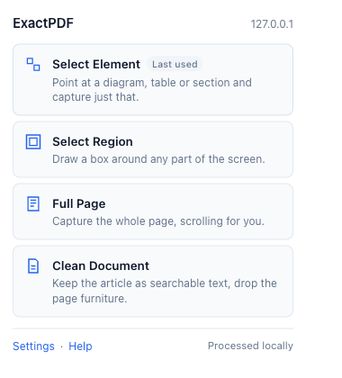
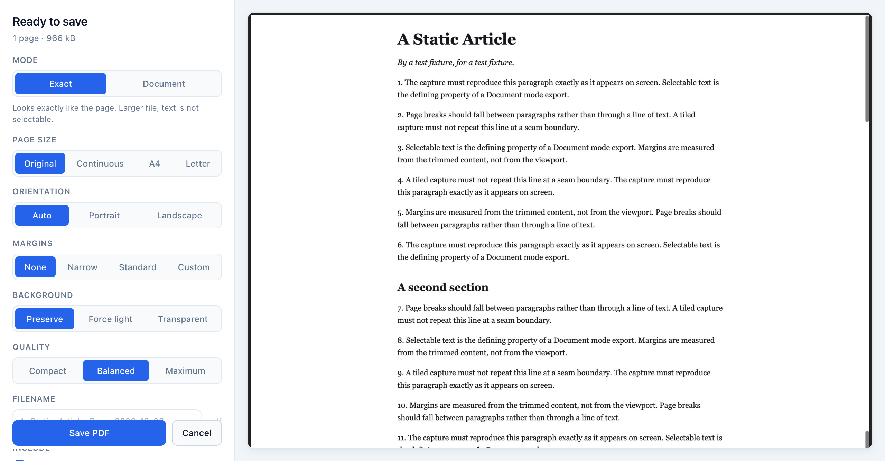

# ExactPDF

**Select and save web content as PDF — locally, and without the print dialogue.**

ExactPDF is a browser extension for Chrome, Brave and other Chromium browsers that
converts exactly what you select on a webpage into a clean PDF. Pick an element,
drag a region, take the whole scrollable page, or extract just the article.
Everything is converted on your own machine.

Printing a webpage to PDF usually gives you the wrong thing: cut-off diagrams,
repeated headers, navigation bars, ads, and page breaks through the middle of a
table. ExactPDF lets you choose the part you actually want and decide whether the
result should look exactly like the screen or read like a clean document.

<p align="center">
  <a href="https://github.com/neverseennightlock24/ExactPDF/releases"><strong>⬇ Download Latest Release</strong></a>
</p>

> **Status:** `1.0.0-beta.1`, a public beta distributed through GitHub Releases.
> ExactPDF is **not** published on the Chrome Web Store; it is installed manually
> using the browser's Developer Mode (instructions below).

<p align="center">
  
</p>

<p align="center">
  
</p>

<sub>Screenshots taken from the real extension in Brave, capturing one of the
repository's test fixture pages.</sub>

---

## What it does

| Mode               | What you get                                                                      |
| ------------------ | --------------------------------------------------------------------------------- |
| **Select Element** | Point at a diagram, table or section; capture just that, cropped to its edges.    |
| **Select Region**  | Drag a box anywhere on screen, then nudge and resize it before capturing.         |
| **Full Page**      | The whole scrollable page, stitched together, with sticky headers appearing once. |
| **Clean Document** | The article as searchable text with working links, minus navigation and ads.      |

Every capture opens a preview where you choose the output mode, page size,
orientation, margins, background, quality, filename and metadata — and the
preview _is_ the generated PDF, so what you see is what downloads.

Captures can also be started from the right-click menu ("Save selected element as
PDF", "Save image as PDF") or with keyboard shortcuts: `Alt+Shift+E` for an
element and `Alt+Shift+R` for a region.

### Exact or Document?

|              | Optimises for                        | Trade-off                                     | Best for                                      |
| ------------ | ------------------------------------ | --------------------------------------------- | --------------------------------------------- |
| **Exact**    | Visual fidelity                      | Image-based, larger file, text not selectable | Diagrams, interfaces, charts, unusual layouts |
| **Document** | Searchable text and clean pagination | Simplifies complex styling                    | Articles, documentation, conversations        |

## Install

ExactPDF works in **Google Chrome 120 or newer**, **Brave**, **Microsoft Edge**
and other Chromium-based desktop browsers. Firefox, Safari and mobile browsers
are not supported.

1. Open the [Releases page](https://github.com/neverseennightlock24/ExactPDF/releases)
   and download `exactpdf-<version>.zip` from the newest release's **Assets**.
   (Download the ZIP asset, not "Source code".)
2. Unzip it. The resulting folder contains `manifest.json` directly inside it.
3. Move that folder somewhere permanent, such as your Documents folder. The
   browser loads the extension from this folder every time it starts, so
   deleting or moving it later will break the extension.
4. Open your browser's extensions page:

   | Browser        | Address                               |
   | -------------- | ------------------------------------- |
   | Chrome         | `chrome://extensions`                 |
   | Brave          | `brave://extensions`                  |
   | Edge           | `edge://extensions`                   |
   | Other Chromium | Menu → Extensions → Manage extensions |

5. Turn on **Developer mode** (a toggle in the top-right corner in Chrome and
   Brave, or the left sidebar in Edge).
6. Click **Load unpacked** and select the unzipped folder — the one that
   contains `manifest.json`.
7. ExactPDF appears in the list. Pin it from the puzzle-piece menu in the
   toolbar so the button is always visible.

If **Load unpacked** reports "Manifest file is missing or unreadable", you
selected the folder one level too high or too low; choose the folder that
contains `manifest.json` itself.

Each release also includes a `.sha256` file. To check your download, run
`shasum -a 256 exactpdf-<version>.zip` (macOS, Linux) or
`Get-FileHash exactpdf-<version>.zip` (Windows PowerShell) and compare.

### Update

Manually installed extensions do not update themselves.

1. Download the newer ZIP from the Releases page and unzip it.
2. Replace the contents of your existing ExactPDF folder with the new files.
3. On the extensions page, press the **reload** (circular arrow) icon on the
   ExactPDF card. The card shows the new version number.

Your settings are kept, because they belong to the installed extension rather
than to the folder. (If you instead load the new version from a _different_
folder, the browser treats it as a separate extension with fresh settings;
remove the old one.)

### Uninstall

Press **Remove** on the ExactPDF card in the extensions page, then delete the
folder. You can turn Developer mode back off if no other unpacked extensions
need it.

## Privacy and permissions

ExactPDF has no server and no account. No page content, screenshot, extracted
text, URL, page title or PDF is transmitted anywhere. Conversion happens in the
extension, on your device. See [PRIVACY.md](PRIVACY.md).

Only four permissions are requested, each tied to a visible feature:

| Permission     | Why                                                                                  |
| -------------- | ------------------------------------------------------------------------------------ |
| `activeTab`    | Temporary access to the tab you are on, granted only after you invoke the extension. |
| `scripting`    | Injects the selection overlay or extraction code for the mode you chose.             |
| `storage`      | Saves your export preferences and hands the in-progress capture to the preview tab.  |
| `contextMenus` | Adds the right-click "Save … as PDF" actions.                                        |

There is deliberately **no** `<all_urls>`, no `debugger`, no `downloads`, no
`tabs`, no history and no cookie access. Downloads are started from a blob URL on
the extension's own page, which needs no additional permission.

Because the release is not reviewed by a store, you are trusting this
repository directly. The release ZIP is built from the tagged source by the
[release workflow](.github/workflows/release.yml), and the shipped JavaScript is
deliberately unminified so it can be read.

## Known limitations

- Chrome blocks extensions from its own pages (`chrome://`, parts of the Web
  Store). Those cannot be captured at all.
- Cross-origin frames may not expose their contents; a region capture still works.
- Very long and infinite-scrolling pages are captured up to a defined limit.
- Document mode uses the fonts built into every PDF reader, which cover Latin
  scripts. Other writing systems are preserved by Exact mode instead.
- Canvas and WebGL content has no underlying text, so it is captured visually.
- Installed through Developer Mode, so there are no automatic updates, and some
  browsers may remind you that developer-mode extensions are enabled.

See [Compatibility](docs/compatibility.md) for the full matrix and limits.

## Acceptable use

ExactPDF captures content already visible to you in your browser. You are
responsible for respecting copyright, confidentiality and website terms. It is
not a tool for bypassing paywalls, logins, DRM or download controls, and it
contains no logic for extracting protected audio or video.

---

## Development

This section is for contributors. To use ExactPDF, follow [Install](#install)
instead.

### Build from source

```bash
npm ci
npm run build
```

Then load the generated `dist/` folder through **Load unpacked**, as above.

```bash
npm run dev          # rebuild on change
npm test             # unit and integration tests
npm run test:e2e     # end-to-end tests in a real browser
npm run verify       # format, lint, typecheck and test
npm run package      # production build plus the release ZIP
```

Requires Node 20 or newer. `npm run test:e2e` needs a Chromium-based browser
(Playwright's Chromium via `npx playwright install chromium`, or a local
Chromium or Brave); it skips cleanly when none is found. It builds `dist/` with an
extra host permission for automation, so always run `npm run package` or
`npm run build` afterwards before loading `dist/` by hand.

### Releasing

The version lives in `package.json` and is the only place it is set.

1. Update `version` in `package.json` (for example `1.0.1` or `1.1.0-beta.1`),
   add a `CHANGELOG.md` entry, and optionally write release notes in
   `docs/releases/v<version>.md`.
2. Run `npm run package`. It rebuilds `dist/`, runs the pre-release checks
   (permissions, no host access, no source maps, no remote code, only runtime
   file types) and writes to `release/`:
   - `exactpdf-<version>.zip` — the asset users download, with `manifest.json`
     at the archive root
   - `exactpdf-<version>.zip.sha256` — its checksum
   - `exactpdf-<version>.files.txt` — the archive's file list, for review
3. Commit, then push a matching tag: `git tag v<version> && git push origin v<version>`.
   The [release workflow](.github/workflows/release.yml) reruns every check,
   including the end-to-end tests, builds the ZIP, and attaches it to a **draft**
   GitHub Release. Review the draft and press **Publish release**.

Chrome's manifest `version` accepts only integers, so a prerelease such as
`1.0.0-beta.1` ships as `version: "1.0.0"` with `version_name: "1.0.0-beta.1"`,
which is what the extensions page displays. Packaging is reproducible: the same
`dist/` always produces a byte-identical ZIP.

### Repository layout

```
src/background/       service worker and capture orchestration
src/content/          selection overlays and page extraction
src/capture/exact/    tiled visual capture, stitching, auto-crop
src/capture/document/ semantic extraction and sanitization
src/pdf/              PDF rendering and page layout
src/preview/          preview application
src/popup/            toolbar popup
src/options/          settings and help
src/shared/           contracts, errors, utilities, constants
tests/unit/           deterministic module tests
tests/integration/    messaging, storage and renderer tests
tests/e2e/            real-browser workflows
tests/fixtures/sites/ generated difficult-page fixtures
scripts/              build, manifest generation and packaging
docs/                 architecture, privacy, compatibility, decisions, releases
```

## Documentation

- [Architecture](docs/architecture.md)
- [Compatibility](docs/compatibility.md) — what works, what does not, and why
- [Privacy policy](PRIVACY.md)
- [Security policy](SECURITY.md)
- [Contributing](CONTRIBUTING.md)
- [Changelog](CHANGELOG.md)
- [Decision records](docs/decisions/)

## Licence

[MIT](LICENSE)
